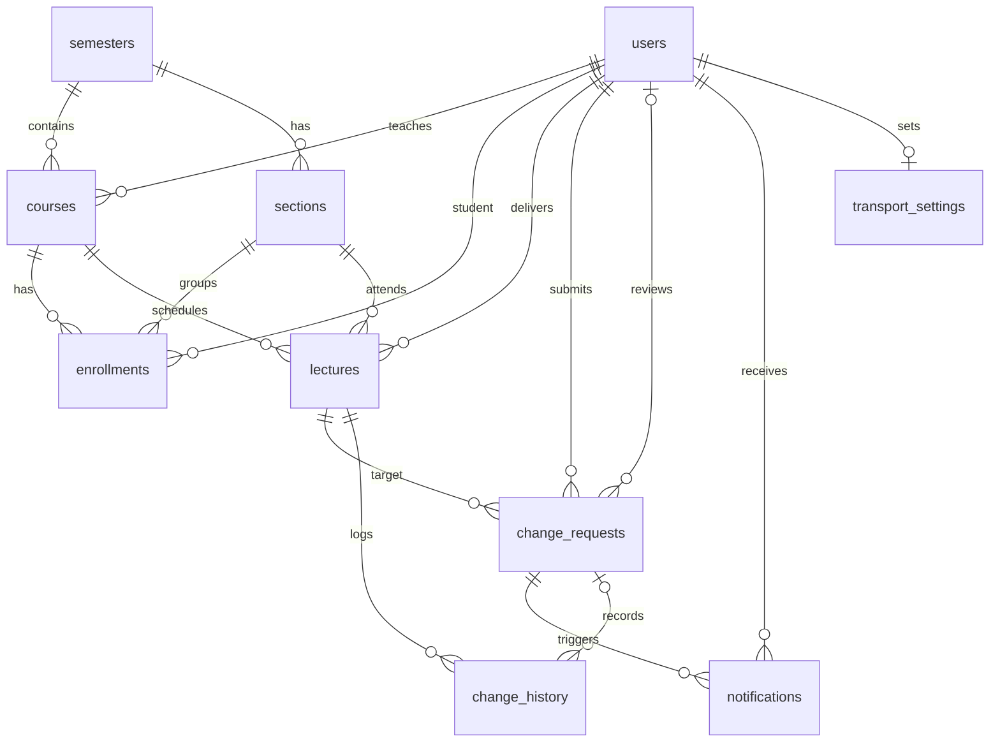

# Database design

## Entity relationship diagram

## Tables

| Table | Purpose |
|---|---|
| users | All accounts. `role` is student, instructor or admin. Passwords are stored as hashes. |
| semesters | A teaching term with start and end dates. |
| sections | A student group within a semester. |
| courses | A course with a code, a semester and one instructor. |
| enrollments | Links a student to a course and a section. Unique per student and course. |
| lectures | The official timetable. The `original_*` columns are never edited. |
| change_requests | A proposed change. Stays separate from the lecture until approved. |
| notifications | One in-app message per student, created on approval, with read status. |
| change_history | Append-only audit trail of what happened and who did it. |
| transport_settings | Optional student commute data. Designed, not yet used by the interface. |

## Key decisions

1. **Original timetable is preserved.** Approval only changes `lectures.status`. The `original_*` columns are never updated.
2. **Proposed and approved are separate.** A request is a row in `change_requests` with status pending, approved or rejected. Students see only approved ones.
3. **24-hour rule.** `lectures.original_start_at` (UTC) minus 24 hours gives `change_requests.deadline_at`. The server computes it. `is_late` records whether the request missed it.
4. **Late requests.** They are allowed with an emergency explanation in `late_justification`, and they are flagged everywhere they appear.
5. **Accountability.** `requested_by`, `reviewed_by`, `submitted_at` and `reviewed_at` record who did what and when.
6. **Audit trail.** Triggers reject any UPDATE or DELETE on `change_history`.
7. **Time.** All times are stored in UTC and converted to Pakistan time for display.
8. **Integrity.** Foreign keys connect every table. Approval runs in a transaction so the status change, notifications and history are saved together or not at all.